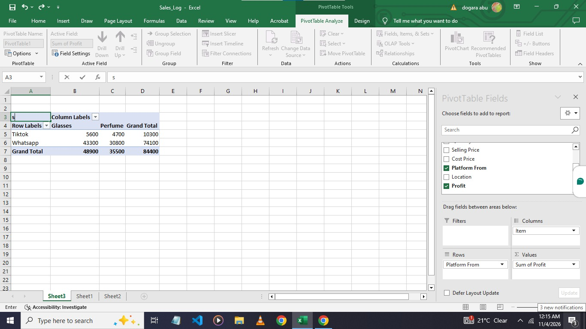

# Dat's Collection: Sales Analysis (Excel)

## The problem
I run Dat's Collection Ventures, an accessories and fragrance business that sells mainly through social media. I wanted to know: which products earn the most, and which platform brings the most profit?

## The data
- 20 real sales from my business, August to October 2026
- Fields: date, item, category, quantity, selling price, cost price, platform, location, profit
- Location: Jos, Plateau State, Nigeria

## What I did
- Entered and organized the sales records in Excel
- Corrected my profit formula, which was dividing instead of subtracting: Profit = (Selling Price - Cost Price) x Quantity
- Fixed dates stored as text and corrected typos in column headers
- Converted the data into an Excel Table
- Built a pivot table of profit by item and platform
- Added a month column, built monthly, platform and item pivots, and made a dashboard
## Findings
- Total profit: N84,400
- Glasses earned N48,900 from 13 sales (about N3,760 per sale)
- Perfume earned N35,500 from 7 sales (about N5,070 per sale)
- WhatsApp produced N74,100 (about 88% of profit); TikTok produced N10,300 from 2 sales
- 

## What this suggests
- Perfume earns more per sale, so it may be worth promoting more
- WhatsApp is my main sales channel, so it deserves most of my effort
- TikTok has very few sales so far, so I need more data before judging it
## Dashboard

## Monthly analysis
| Month | Glasses | Perfume | Total profit |
|---|---|---|---|
| Aug | N19,200 | none | N19,200 |
| Sep | N6,500 | N23,500 | N30,000 |
| Oct | N23,200 | N12,000 | N35,200 |

**What I found:**
- Profit grew 83% from August to October, but sales stayed almost flat (6, 7, 7 per month).
- Growth came from higher profit per sale (about N3,200 in Aug, N4,290 in Sep, N5,030 in Oct).
- Perfume sold less in October (2 sales vs 5), so glasses drove that month.
- Open question: my glasses cost also rose, so is my margin shrinking?
## Limits
This is a small dataset (20 sales), so these are early patterns, not firm conclusions. I will keep adding data as the business grows.

## Files
- `Sales_Log_Clean.xlsx`: cleaned data and pivot table
- `pivot-table.jpeg`: pivot table screenshot

## Next steps
SQL analysis of the same data and a dashboard (in progress)

## Contact
daniangj61@gmail.com
## What this suggests
- Perfume earns more per sale, so it may be worth promoting more
- WhatsApp is my main sales channel, so it deserves most of my effort
- TikTok has very few sales so far, so I need more data before judging it

## Limits
This is a small dataset (20 sales), so these are early patterns, not firm conclusions. I will keep adding data as the business grows.

## Files
- `Sales_Log_Clean.xlsx`: cleaned data and pivot table

## Next steps
SQL analysis of the same data and a dashboard (in progress)

## Contact
daniangj61@gmail.com
